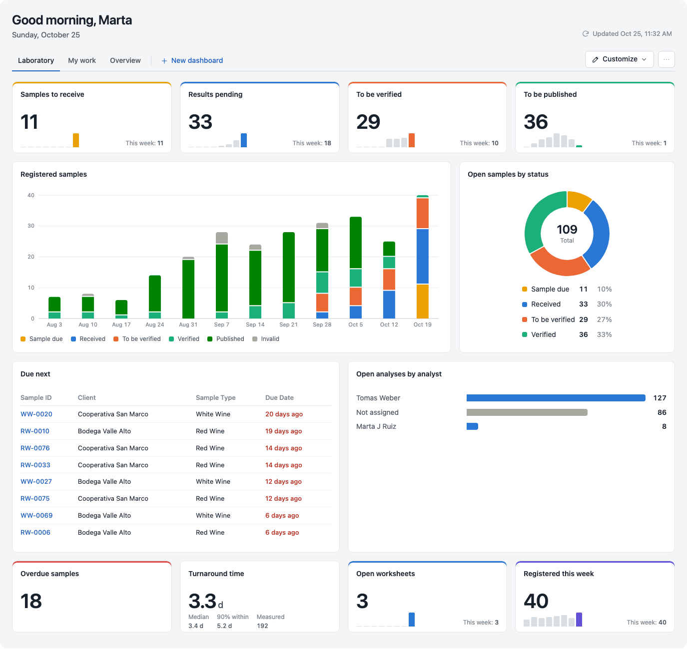
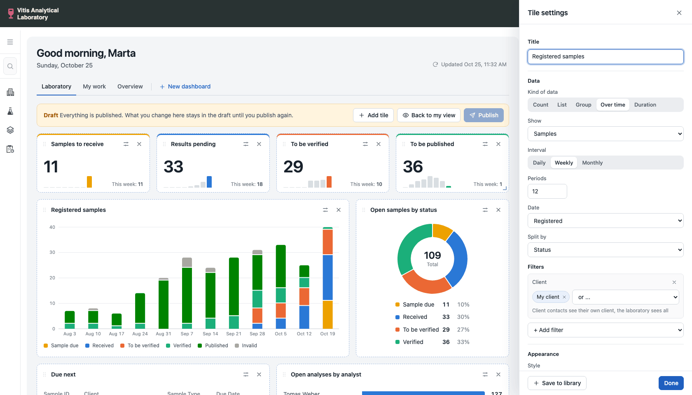
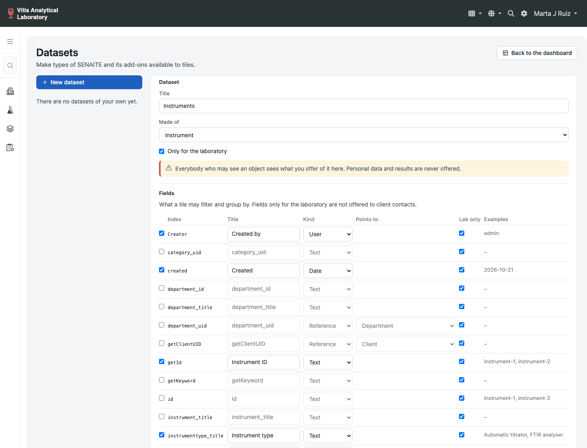

.. default-role:: literal

SENAITE DASHBOARD
=================

Configurable dashboards for SENAITE.

Every signed-in user gets a dashboard of tiles: numbers with their
course over the last weeks, bars, donuts, charts over time, tables,
links and notes in Markdown. Tiles are moved by drag and drop and
resized at their corner. A user changes the dashboard for themselves;
what everybody starts from is up to the laboratory management, who
edit it as a draft and publish it when it is ready.

Tiles come from a library of ready-made ones, or are built from
scratch by choosing the kind of data, the dataset, filters and how it
shows. Managers save tiles worth having to the library for everybody,
and make further types of SENAITE and its add-ons available to tiles
on a page of their own.

The add-on takes the place of the SENAITE dashboard
(`@@senaite-dashboard`) on the sites it is installed on.

         donut by status, a table of samples due and bars per analyst

Installation
------------

Add `senaite.dashboard` to the eggs of the instance, run buildout,
restart, and install *SENAITE DASHBOARD* in the add-ons control panel.
The installation creates three published dashboards: *Laboratory* and
*My work* for the laboratory roles, *Overview* for client contacts.
Installing again leaves the dashboards that are there alone; a manager
brings back the ones that were deleted with *Restore default
dashboards* in the menu of a dashboard.

Who may do what
---------------

`senaite.dashboard: View Dashboard`
    See the dashboard. Granted to *Authenticated*.

`senaite.dashboard: Customize Dashboard`
    Rearrange a global dashboard for oneself and keep personal
    dashboards. Granted to *Authenticated*.

`senaite.dashboard: Manage Global Dashboards`
    Create, edit, publish and delete the dashboards everybody starts
    from, decide which roles see them, save tiles to the library and
    define datasets. Granted to *Manager* and *LabManager*.

Every number on a dashboard is computed with the permissions of the
user looking at it. A tile on a global dashboard shows a client
contact the samples of their client and the laboratory all samples.

What keeps data where it belongs:

- Every search goes through the catalog as the current user. The
  dashboard shows what the SENAITE listings show, no more.
- Seeing an analysis is not seeing its result: the result column is
  checked per row against *View Results*, so a client contact reads a
  result only once the workflow lets them.
- The choices a filter offers come from the objects the user may see,
  never from the whole index. Titles of referenced objects are shown
  only when the user may view the object.
- Tile parameters are reduced to what the data source declares and
  checked for their kind before anything runs; one request may cause
  only so many catalog searches.
- Changes are POSTs with a JSON body; a change sent from another site
  (by its Origin header) is refused.
- Answers are cached for users who see the same: the same roles, the
  same client, laboratory staff or not. They are dropped as soon as
  the catalog of the dataset changes, and kept five minutes at most.
- Notes are Markdown rendered by the script as elements, never as
  HTML; a link leads to a page of the site, the web or an e-mail
  address only.
- A dataset defined in the browser offers no index or metadata of
  the catalog itself, of who may see an object, of personal data or
  of results, and is for the laboratory only unless opened. Columns of
  fields for the laboratory only are not shown to client contacts
  either.

Kinds of dashboards
-------------------

Global
    Made by a manager, visible for all users or for some roles. It has
    a *draft* and a *published* version. Users see the published one;
    a manager edits the draft ("Edit for everybody") without anybody
    noticing, and publishes it when it is done. "Discard changes" goes
    back to what is published. While the draft has changes that are
    not published, a manager sees a notice on the dashboard that leads
    to the draft.

    Deleting a global dashboard deletes it for everybody, together
    with what users changed on it, and cannot be undone. *Restore
    default dashboards* adds the default ones that are missing again,
    as drafts; the dashboards that are there stay as they are.

Customized global
    A user who rearranges a global dashboard ("Customize for me") does
    not get a copy of it. Only what they changed is kept: tiles they
    hid, the settings they changed per tile, and tiles they added.
    Tiles a manager publishes later still show up for them. "Reset to
    default" drops their changes.

Personal
    Made by a user, for themselves only.

         tile open next to it

Architecture
------------

The package has three parts. `dashboards/` keeps the dashboards and
decides who may change what; it never computes a number. `query/`
answers the tiles; it knows nothing about dashboards. `library/` is
the tile library. The web layer on top ties them together:

.. code-block:: text

    Browser (React, react-grid-layout)       webpack/app
        |  one request for the data of all tiles
        v
    routes/       JSON API below @@API/senaite/v1/dashboard
                  base, dashboard, data, library, datasets
    browser/      the pages, with what their script starts from
    app.py        what the pages start from
    strings.py    the texts of the pages
        |
        +-- dashboards/   what users see and change
        |     model.py      tiles and overlays (pure functions)
        |     shared.py     global dashboards: draft, publish
        |     personal.py   personal dashboards and overlays
        |     views.py      a dashboard as the page shows it
        |     ids.py, defaults.py
        |
        +-- library/      the tile library
        |     presets.py    what the library shows a user
        |     builtin.py    the presets the add-on ships with
        |     builders.py   what presets are built with
        |     saved.py      tiles managers saved
        |
        +-- query/        how a tile gets its numbers
              compute.py    the entry point: check, run, cache
              sources.py    count, group, timeseries, list, span
              registry.py   where a tile finds its dataset
              datasets.py   fields, columns, spans of a dataset
              builtin.py    samples, analyses, worksheets
              custom.py     datasets defined in the browser, with
              catalogs.py   what the catalogs offer to them and
              inspection.py proposals with examples
              fields.py, search.py, labels.py, params.py,
              variables.py, timeline.py, calendar_dates.py,
              vocabularies.py

Next to the parts: `storage.py` keeps everything in an annotation on
the site, `access.py` checks permissions, `env.py` is the current
user and time of a request, `titles.py` handles titles in one or
several languages, `interfaces.py` names what add-ons plug in.

Where to start
--------------

To understand how a tile gets its numbers, read `query/compute.py`,
then one source in `query/sources.py` (`GroupSource` is a good one;
each source describes the shape of its answer) and a dataset in
`query/builtin.py`. To understand dashboards, read the docstring of
`dashboards/model.py`, then `dashboards/shared.py` and
`dashboards/personal.py`. Each part lists its modules in reading order
in its `__init__.py`.

In the browser, `webpack/app/index.js` mounts one of two pages:
`components/App.jsx` is the dashboard, with its state in
`hooks/useDashboard.js`; `datasets/DatasetsApp.jsx` is the page of
the datasets. A tile is drawn by the component of its type
(`tiles/`), and edited in `settings/TileSettings.jsx`.

The page carries everything it needs to start (dashboards, datasets,
the tile library, translated texts), so the first paint does not wait
for a request. The data of all tiles then comes in one request.

The query language
------------------

A tile names a data source and its parameters:

.. code-block:: json

    {"id": "a1b2c3d4", "type": "kpi", "title": "To be verified",
     "source": "count",
     "params": {"dataset": "samples",
                "filters": {"review_state": ["to_be_verified"],
                            "getClientUID": "$client"},
                "trend": {"date_field": "created", "interval": "week",
                          "periods": 8}},
     "options": {"color": "orange", "link": "samples"},
     "layout": {"x": 0, "y": 0, "w": 3, "h": 2}}

Datasets
    `samples`, `analyses` and `worksheets`, those of add-ons, and
    those managers define in the browser. A dataset names the catalog,
    the fields a tile may filter and group by, the columns a table may
    show and the spans of time it can measure. Nothing outside of it
    can be asked for. Fields that only make sense in the laboratory
    (analyst, instrument, worksheets) are not offered to client
    contacts.

Filters
    `{field: value}`, `{field: [values]}` (any of them),
    `{field: {"not": [values]}}`, and for dates
    `{field: {"min": ..., "max": ...}}`.

Placeholders
    `$user`, `$client`, `$now`, `$today`, `$week`,
    `$month`, `$year`, dates with an offset such as
    `$today-30d` (units h, d, w, m, y). `$client` of a laboratory
    user is unset, and a filter on it is left out.

Data sources
    `count` (a number, optionally its course over time), `group`
    (numbers per value of a field), `timeseries` (numbers per day,
    week or month, optionally split by a field), `list` (the first
    objects with some of their columns) and `span` (how long it takes
    between two dates, e.g. the turnaround time).

What the catalog cannot answer (numeric results, out of range rates,
joins across catalogs, history) belongs in a data source of its own,
for example on top of a copy of the data in a relational database.

Datasets in the browser
-----------------------

Managers open *Manage datasets* in the menu of a dashboard
(`@@dashboard-datasets`). They pick a type, tick the indexes tiles may
filter and group by and the metadata tables may show, each with a
title and a kind the page proposes from the catalog, and add spans of
time between two dates. Examples next to each index and column show
what a tile would show.

         their titles, kinds and examples

Only types with a catalog of their own are offered, those of SENAITE
and its add-ons; Document, Folder and the like are not, nor are
Patient and the site itself. Indexes and metadata the catalog needs
for itself, the roles and users that may see an object, personal data
and results are never offered: the catalog knows no permission per
field, so a dataset could not keep them from a user who may see the
object. New datasets and their fields are for the laboratory only.

A saved dataset is offered on the dashboard once it is loaded again.
Deleting one tells how many global dashboards and saved tiles use it;
their tiles then say the dataset is gone.

Extending
---------

Datasets, data sources and tile library entries are named utilities:

.. code-block:: xml

    <utility
        component=".datasets.INSTRUMENTS"
        provides="senaite.dashboard.interfaces.IDashboardDataset"
        name="instruments" />

    <utility
        factory=".sources.CalibrationSource"
        provides="senaite.dashboard.interfaces.IDashboardDataSource"
        name="calibration" />

    <utility
        factory=".library.MyPresets"
        provides="senaite.dashboard.interfaces.IDashboardPresetProvider"
        name="my.addon" />

An add-on that indexes more about objects of an existing dataset adds
fields, columns and spans to it instead of defining a dataset of its
own:

.. code-block:: python

    from senaite.dashboard.query.datasets import Column
    from senaite.dashboard.query.datasets import DatasetExtension
    from senaite.dashboard.query.fields import TEXT
    from senaite.dashboard.query.fields import Field

    SAMPLES = DatasetExtension(
        "samples",
        fields=[Field("lab_order", _("Lab Order"), TEXT)],
        columns=[Column("lab_order", _("Lab Order"),
                        getter=read_lab_order)],
    )

.. code-block:: xml

    <utility
        component=".datasets.SAMPLES"
        provides="senaite.dashboard.interfaces.IDashboardDatasetExtension"
        name="my.addon.samples" />

A field of kind `choice` has a fixed list of values with titles; the
tile editor offers them and grouped tiles show them in that order. A
column with a `getter` shows a value the catalog keeps no metadata
column for; the getter runs for the shown rows only. Two getters come
with the add-on: `index_getter(catalog, index)` reads the value from
the index without waking the object, `choice_getter(field)` shows the
title of the value of a choice field:

.. code-block:: python

    RECEIPT = Field("receipt_status", _("Receipt"), CHOICE,
                    choices=[("pending", _("Not sent")),
                             ("sent", _("Sent"))])

    Column("receipt_status", _("Receipt"),
           getter=choice_getter(RECEIPT, getter=index_getter(
               MY_CATALOG, "receipt_status")))

A preset provider with `categories`, `[(id, title)]`, gets categories
of its own in the tile library. `library/builders.py` has the
builders the library itself is made of (`kpi`, `group`, `chart`,
`table`, `span`, `tile_params`, `samples`) and
`to_presets(category, entries)`, which turns `(id, description,
tile)` entries into presets.

A data source is called with the parameters of the tile and the
`Environment` of the request, validates the parameters, raises
`QueryError` for anything it does not accept, and searches with the
permissions of the current user.

Tile types are registered in the browser, before the page loads:

.. code-block:: javascript

    window.senaite.dashboard.registerTileType("gauge", {
      label: "Gauge", icon: "kpi", accepts: ["scalar"],
      component: GaugeTile, size: {w: 3, h: 2}
    });

A tile type that fails to render shows an error in its own tiles and
nowhere else.

Development
-----------

The frontend lives in `webpack/` and builds into
`src/senaite/dashboard/browser/static`:

.. code-block:: bash

    cd webpack
    yarn install
    yarn build      # or: yarn watch
    yarn lint       # names used but never defined or imported

React comes from `senaite.core` as a global; it is never bundled.
Webpack builds a bundle that uses a name it never imports without a
word; `yarn lint` finds those before the browser does.

To bring back the default dashboards on a development database, with
the instance stopped (this deletes all global dashboards first):

.. code-block:: bash

    bin/instance run \
        src/senaite.dashboard/src/senaite/dashboard/devtools/reset_defaults.py \
        senaite

Tests, from the buildout:

.. code-block:: bash

    TZ=Europe/Berlin bin/test-senaite -s senaite.dashboard

Translations, from the package: the script rebuilds the catalog and
syncs the languages; fill in the new German texts, then compile them.

.. code-block:: bash

    scripts/update_translations.sh
    cd src/senaite/dashboard/locales/de/LC_MESSAGES
    msgfmt -o senaite.dashboard.mo senaite.dashboard.po
