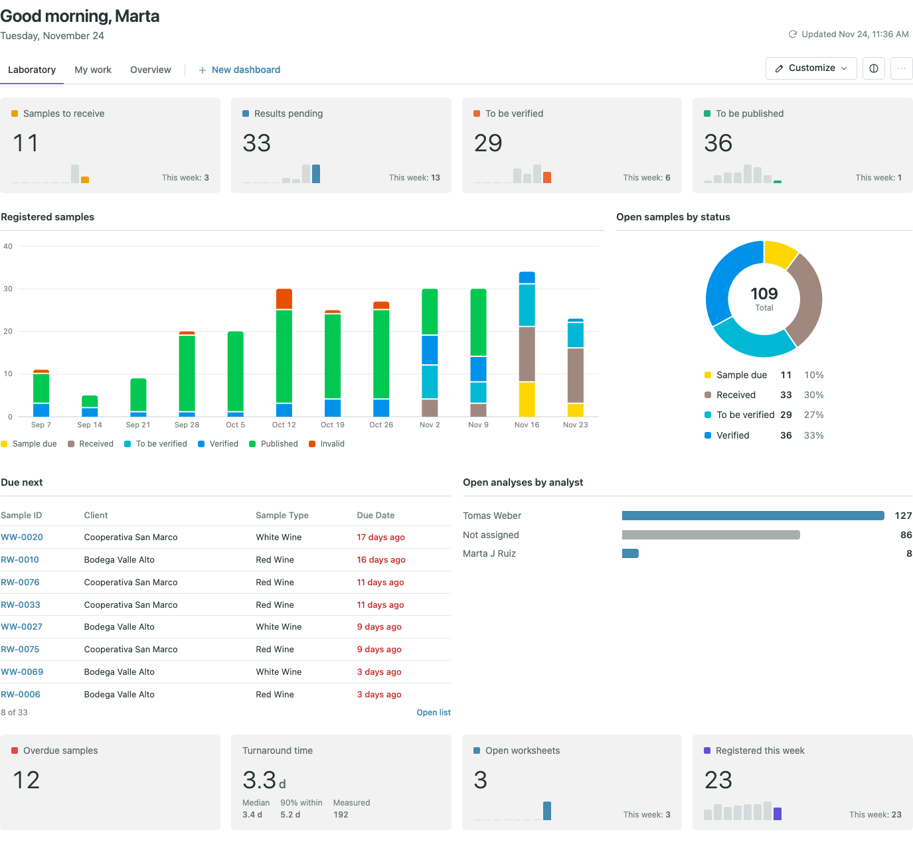
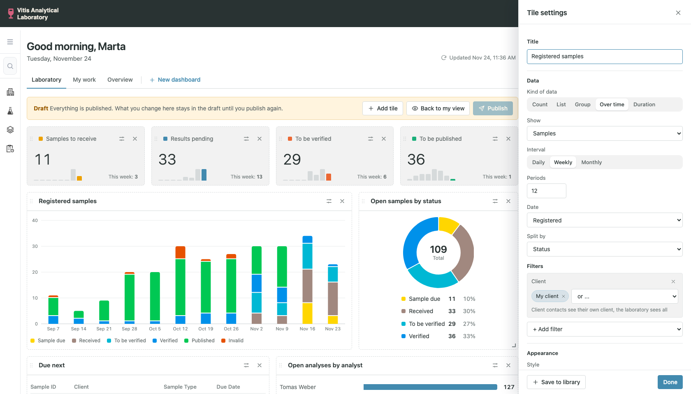
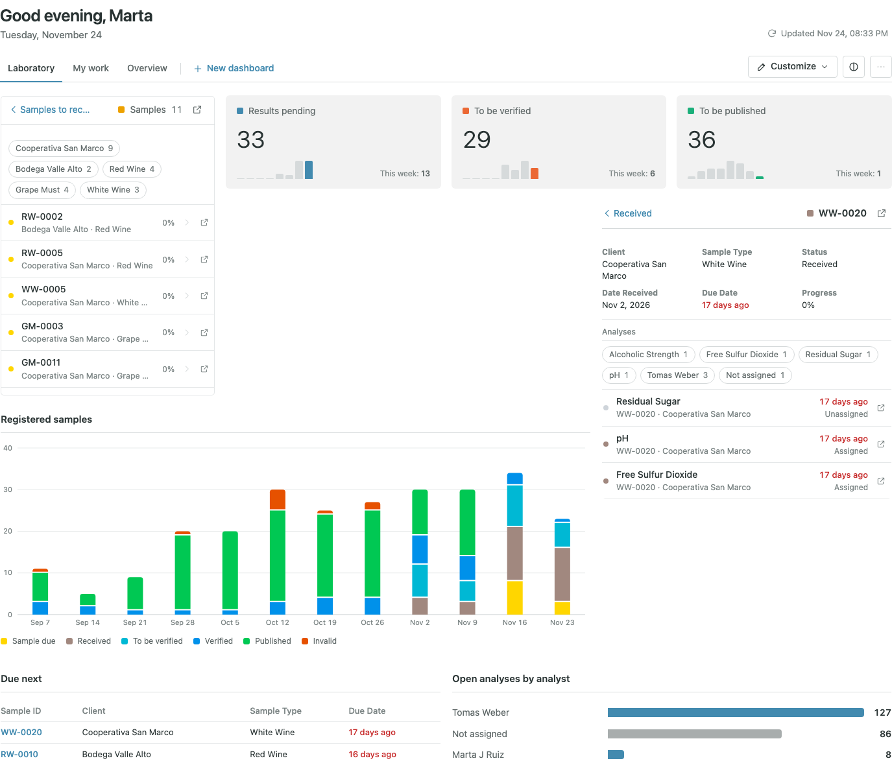
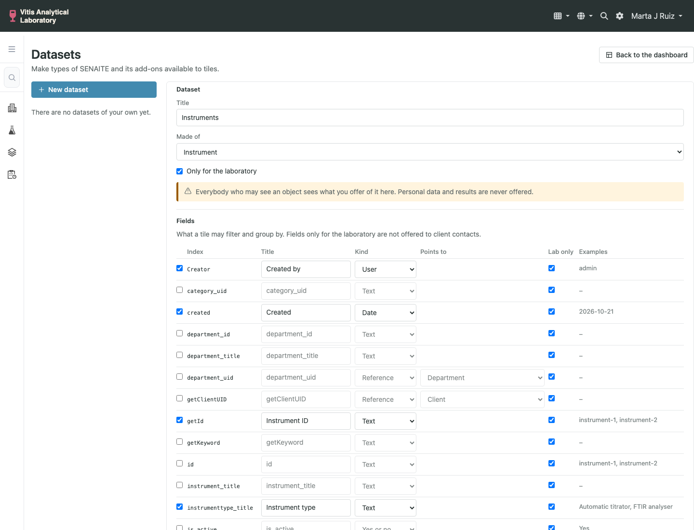

.. default-role:: literal

SENAITE DASHBOARD
=================

Configurable dashboards for SENAITE.

Every signed-in user gets a dashboard of tiles: numbers with their
course over the last weeks, bars, donuts, charts over time, tables,
links and notes in Markdown. Tiles are moved by drag and drop and
resized at their corner. A user changes the dashboard for themselves;
what everybody starts from is up to the laboratory management, who
edit it as a draft and publish it when it is ready.

Tiles come from a library of ready-made ones, or are built from
scratch by choosing the kind of data, the dataset, filters and how it
shows. Managers save tiles worth having to the library for everybody,
and make further types of SENAITE and its add-ons available to tiles
on a page of their own.

The add-on takes the place of the SENAITE dashboard
(`@@senaite-dashboard`) on the sites it is installed on.

         donut by status, a table of samples due and bars per analyst

Requirements
------------

SENAITE 2.7 with `senaite.jsonapi`, on Python 2.7. Translations are
compiled when the instance starts, with `zope_i18n_compile_mo_files`
set, as the SENAITE buildouts and images do.

Installation
------------

Add `senaite.dashboard` to the eggs of the instance, run buildout,
restart, and install *SENAITE DASHBOARD* in the add-ons control panel.
The installation creates three published dashboards: *Laboratory* and
*My work* for the laboratory roles, *Overview* for client contacts.
Installing again leaves the dashboards that are there alone; a manager
brings back the ones that were deleted with *Restore default
dashboards* in the menu of a dashboard. The titles of the default
dashboards and their tiles are stored in every language the site
offers.

Uninstalling removes the dashboard page and its routes; SENAITE shows
its own dashboard again. The dashboards, the library and the datasets
stay on the site and are back when the add-on is installed again.

Changes are refused when the Origin header of the browser names
another site than the one SENAITE sees itself as. Behind a proxy that
terminates TLS, set up virtual hosting so that SENAITE knows its
public address.

Who may do what
---------------

`senaite.dashboard: View Dashboard`
    See the dashboard. Granted to *Authenticated*.

`senaite.dashboard: Customize Dashboard`
    Rearrange a global dashboard for oneself and keep personal
    dashboards. Granted to *Authenticated*.

`senaite.dashboard: Manage Global Dashboards`
    Create, edit, publish and delete the dashboards everybody starts
    from, decide which roles see them, save tiles to the library and
    define datasets. Granted to *Manager* and *LabManager*.

Every number on a dashboard is computed with the permissions of the
user looking at it. A tile on a global dashboard shows a client
contact the samples of their client and the laboratory all samples.

What keeps data where it belongs:

- Every search goes through the catalog as the current user. The
  dashboard shows what the SENAITE listings show, no more: samples and
  analyses for internal use are left out for users outside the
  laboratory, retracted analyses for users who may not view them.
- Seeing an analysis is not seeing its result: the result column is
  checked per row against *View Results*, so a client contact reads a
  result only once the workflow lets them.
- The choices a filter offers come from the objects the user may see,
  never from the whole index. Titles of referenced objects are shown
  only when the user may view the object.
- Tile parameters are reduced to what the data source declares and
  checked for their kind before anything runs; one request may cause
  only so many catalog searches.
- Changes are POSTs with a JSON body; a change sent from another site
  (by its Origin header) is refused.
- Answers are cached for users who see the same: the same roles, the
  same client, laboratory staff or not. They are dropped as soon as
  the catalog of the dataset changes, and kept five minutes at most.
- Notes are Markdown rendered by the script as elements, never as
  HTML; a link leads to a page of the site, the web or an e-mail
  address only.
- A dataset defined in the browser offers no index or metadata of
  the catalog itself, of who may see an object, of personal data or
  of results, and is for the laboratory only unless opened. So is
  each of its fields and columns; a column of a field for the
  laboratory only stays so. Only catalogs that filter by who may see
  an object are offered.

Kinds of dashboards
-------------------

Global
    Made by a manager, visible for all users or for some roles. It has
    a *draft* and a *published* version. Users see the published one;
    a manager edits the draft ("Edit for everybody") without anybody
    noticing, and publishes it when it is done. "Discard changes" goes
    back to what is published. While the draft has changes that are
    not published, a manager sees a notice on the dashboard that leads
    to the draft.

    Deleting a global dashboard deletes it for everybody, together
    with what users changed on it, and cannot be undone. *Restore
    default dashboards* adds the default ones that are missing again,
    as drafts; the dashboards that are there stay as they are.

Customized global
    A user who rearranges a global dashboard ("Customize for me") does
    not get a copy of it. Only what they changed is kept: tiles they
    hid, the settings they changed per tile, and tiles they added.
    Tiles a manager publishes later still show up for them. "Reset to
    default" drops their changes.

Personal
    Made by a user, for themselves only.

         tile open next to it

Opening a tile
--------------

A click on a number opens the tile to the objects it counts: a part
of a donut or its line in the legend, a bar of a bar list, a column of
a chart or a part of it, or the number of a count. The tile shows them
as rows in place, the way a list on a phone does: the way back is on
the left of its head, Esc goes back too. A small tile grows for as
long as it is open; the dashboard is not changed by it.

The rows come from the same search the tile counts with, narrowed by
the part clicked, so their number is the number of the part. Chips
above the rows narrow them further, by the client or the sample type
of a sample, or the analysis or analyst of an analysis, with the
number each leaves. A row opens in the tile when there is more below
it: a sample shows its analyses with their results, an analysis opens
its sample, a worksheet shows its analyses. The icon at the end of a
row leads to the object in SENAITE, the one in the head of the tile to
the list or the object shown. The list is a listing of exactly the
objects of the part, narrowed by the chips picked: for samples the
samples listing of SENAITE with its buttons and actions, for other
datasets a listing of their columns. Its URL carries the request of
the tile, and the objects are searched again with it, as the user who
opens the page.

         samples they count, and an analysis opened to its sample

Themes and colors
-----------------

The dashboard looks like SENAITE: it sits on the page without boxes
around its tiles, a section is set apart by the rule under its
heading, as in the listings, and numbers sit on the light grey band of
SENAITE.

Every color is a custom property (`--sd-...`) of a theme in
`webpack/app/styles/_themes.scss`. A theme is one Sass map there: the
surfaces, text, lines, accent, feedback colors, the colors of the
workflow states and the colors of groups without a meaning of their
own. A new theme is a new map; nothing else changes. The theme on
screen is named by `data-sd-theme` on the root element of the page:
`light`, `dark`, or `auto`, which follows the system. Users switch it
in the menu next to the actions of a dashboard; the choice is kept in
the browser, and the page starts in the light theme.

The light theme takes the colors of SENAITE: the ink and greys of
`senaite.core`, the grey of the logo and the link blue as accent. The
workflow states have the colors of the SENAITE listings, so a state
looks the same everywhere; where the listing tone is too pale for a
mark on white (sample due, to be verified), the stronger tone of the
same color is used.

The script never holds a color of its own: `colors.js` hands out
references to the custom properties, by the meaning of what they
color, and charts set them as style. The color of a number tile is a
name: a color (`blue`, `orange`, ...) or a workflow state
(`to_be_verified`, `published`, ...), whose color it then takes.

Architecture
------------

The package has three parts. `dashboards/` keeps the dashboards and
decides who may change what; it never computes a number. `query/`
answers the tiles; it knows nothing about dashboards. `library/` is
the tile library. The web layer on top ties them together:

.. code-block:: text

    Browser (React, react-grid-layout)       webpack/app
        |  one request per tile, three at a time
        v
    routes/       JSON API below @@API/senaite/v1/dashboard
                  base, dashboard, data, library, datasets
    browser/      the pages, with what their script starts from
    app.py        what the pages start from
    strings.py    the texts of the pages
        |
        +-- dashboards/   what users see and change
        |     model.py      tiles and overlays (pure functions)
        |     shared.py     global dashboards: draft, publish
        |     personal.py   personal dashboards and overlays
        |     views.py      a dashboard as the page shows it
        |     usage.py      where a dataset is used
        |     ids.py, defaults.py
        |
        +-- library/      the tile library
        |     presets.py    what the library shows a user
        |     builtin.py    the presets the add-on ships with
        |     builders.py   what presets are built with
        |     saved.py      tiles managers saved
        |
        +-- query/        how a tile gets its numbers
              compute.py    the entry point: check, run, cache
              sources.py    count, group, timeseries, list, span
              registry.py   where a tile finds its dataset
              datasets.py   fields, columns, spans of a dataset
              builtin.py    samples, analyses, worksheets
              custom.py     datasets defined in the browser, with
              catalogs.py   what the catalogs offer to them and
              inspection.py proposals with examples
              fields.py, search.py, labels.py, params.py,
              variables.py, timeline.py, calendar_dates.py,
              vocabularies.py

Next to the parts: `storage.py` keeps everything in an annotation on
the site, `access.py` checks permissions, `env.py` is the current
user and time of a request, `titles.py` handles titles in one or
several languages, `interfaces.py` names what add-ons plug in and
`api.py` what they build with. `upgrades/` keeps the upgrade steps.

Where to start
--------------

To understand how a tile gets its numbers, read `query/compute.py`,
then one source in `query/sources.py` (`GroupSource` is a good one;
each source describes the shape of its answer) and a dataset in
`query/builtin.py`. To understand dashboards, read the docstring of
`dashboards/model.py`, then `dashboards/shared.py` and
`dashboards/personal.py`. Each part lists its modules in reading order
in its `__init__.py`.

In the browser, `webpack/app/index.js` mounts one of two pages:
`components/App.jsx` is the dashboard; `datasets/DatasetsApp.jsx` is
the page of the datasets. The state of the dashboard is in three
hooks: `hooks/useDashboard.js` keeps the dashboard on screen and its
actions, `hooks/useTileData.js` the data of the tiles and
`hooks/useSaveQueue.js` saves changes in order. A tile is drawn by the
component of its type (`tiles/`), and edited in
`settings/TileSettings.jsx`.

The page carries everything it needs to start (dashboards, datasets,
the tile library, translated texts), so the first paint does not wait
for a request. Then every tile asks for its data on its own, three
requests at a time, so the page fills as it goes and a slow tile does
not hold back the others. While it does, three cells of the logo
hexagon light up in the row of the tabs, with how many tiles are ready
next to them; the listings of SENAITE load with the same cells. A
waiting tile shows placeholders in the shape of what comes, and says
so when it takes longer than four seconds. The rows of a table scroll
on their own, so the number of rows and the link to the list stay in
view.

The query language
------------------

A tile names a data source and its parameters:

.. code-block:: json

    {"id": "a1b2c3d4", "type": "kpi", "title": "To be verified",
     "source": "count",
     "params": {"dataset": "samples",
                "filters": {"review_state": ["to_be_verified"],
                            "getClientUID": "$client"},
                "trend": {"date_field": "created", "interval": "week",
                          "periods": 8}},
     "options": {"color": "to_be_verified", "link": "samples"},
     "layout": {"x": 0, "y": 0, "w": 3, "h": 2}}

Datasets
    `samples`, `analyses` and `worksheets`, those of add-ons, and
    those managers define in the browser. A dataset names the catalog,
    the fields a tile may filter and group by, the columns a table may
    show and the spans of time it can measure. Nothing outside of it
    can be asked for. Fields that only make sense in the laboratory
    (analyst, instrument, worksheets) are not offered to client
    contacts.

Filters
    `{field: value}`, `{field: [values]}` (any of them),
    `{field: {"not": [values]}}`, and for dates
    `{field: {"min": ..., "max": ...}}`.

Placeholders
    `$user`, `$client`, `$now`, `$today`, `$week`,
    `$month`, `$year`, dates with an offset such as
    `$today-30d` (units h, d, w, m, y). `$client` of a laboratory
    user is unset, and a filter on it is left out.

Data sources
    `count` (a number, optionally its course over time), `group`
    (numbers per value of a field), `timeseries` (numbers per day,
    week or month, optionally split by a field), `list` (the first
    objects with some of their columns) and `span` (how long it takes
    between two dates, e.g. the turnaround time).

What the catalog cannot answer (numeric results, out of range rates,
joins across catalogs, history) belongs in a data source of its own,
for example on top of a copy of the data in a relational database.

Datasets in the browser
-----------------------

Managers open *Manage datasets* in the menu of a dashboard
(`@@dashboard-datasets`). They pick a type, tick the indexes tiles may
filter and group by and the metadata tables may show, each with a
title and a kind the page proposes from the catalog, and add spans of
time between two dates. Examples next to each index and column show
what a tile would show.

         their titles, kinds and examples

Only types with a catalog of their own are offered, those of SENAITE
and its add-ons; Document, Folder and the like are not, nor are
Patient and the site itself. Indexes and metadata the catalog needs
for itself, the roles and users that may see an object, personal data
and results are never offered: the catalog knows no permission per
field, so a dataset could not keep them from a user who may see the
object. New datasets, their fields and their columns are for the
laboratory only, until a manager opens them to client contacts one by
one.

A saved dataset is offered on the dashboard once it is loaded again.
Deleting one tells how many global dashboards and saved tiles use it;
their tiles then say the dataset is gone.

Extending
---------

Add-ons import what they build on from `senaite.dashboard.api`; the
modules behind it may change, its names stay. Datasets, extensions of
datasets, data sources and tile library entries are named utilities:

.. code-block:: xml

    <utility
        component=".datasets.INSTRUMENTS"
        provides="senaite.dashboard.interfaces.IDashboardDataset"
        name="instruments" />

    <utility
        factory=".sources.CalibrationSource"
        provides="senaite.dashboard.interfaces.IDashboardDataSource"
        name="calibration" />

    <utility
        factory=".library.MyPresets"
        provides="senaite.dashboard.interfaces.IDashboardPresetProvider"
        name="my.addon" />

A dataset is an instance of `Dataset`: the catalog and portal type,
the `Field`s a tile may filter and group by, the `Column`s a table may
show and the `Span`s of time it may measure. Its name is what tiles
refer to; names starting with `custom-` are taken by the datasets
managers define in the browser.

.. code-block:: python

    from senaite.core.catalog import SETUP_CATALOG
    from senaite.dashboard import api

    INSTRUMENTS = api.Dataset(
        name="instruments",
        title=_("Instruments"),
        catalog=SETUP_CATALOG,
        portal_type="Instrument",
        lab_only=True,
        fields=[api.Field("review_state", _("Status"), api.STATE),
                api.Field("created", _("Created"), api.DATE)],
        columns=[api.Column("Title", _("Instrument"))],
    )

An add-on that indexes more about objects of an existing dataset adds
fields, columns and spans to it instead of defining a dataset of its
own. A field of kind `choice` has a fixed list of values with titles;
the tile editor offers them and grouped tiles show them in that order:

.. code-block:: python

    PRINTED = api.Field("getPrinted", _("Printed"), api.CHOICE,
                        choices=[("0", _("Not printed")),
                                 ("1", _("Printed")),
                                 ("2", _("Printed, then republished"))])

    SAMPLES = api.DatasetExtension(
        "samples",
        fields=[PRINTED],
        columns=[api.Column("getClientOrderNumber", _("Order number")),
                 api.Column("getPrinted", _("Printed"),
                            getter=api.choice_getter(PRINTED))],
    )

.. code-block:: xml

    <utility
        component=".datasets.SAMPLES"
        provides="senaite.dashboard.interfaces.IDashboardDatasetExtension"
        name="my.addon.samples" />

A field or column of the same name as one of the dataset replaces it.
A column with a `getter` shows a value the catalog keeps no metadata
column for; the getter runs for the shown rows only. Two getters come
with the add-on: `index_getter(catalog, index)` reads the value from
the index without waking the object, `choice_getter(field)` shows the
title of the value of a choice field, read from the metadata column
of the same name or from the getter it is given.

How the objects of a dataset show when a tile is opened is up to the
dataset, too. A `Card` names the columns of a row: the title, the
columns of the line below it, the columns on the right of which the
first with a value is shown, and one below them. Without a card, a
row shows the first columns. `facts` are the columns shown of an
opened object, `facets` the fields its rows can be narrowed by and
`sort` the order of the rows, `drill_view` the page below the site
that lists exactly the objects of a part (by default the plain listing
`dashboard-objects`). A `Link` leads from an object to others:
`children` are shown below an opened object, `parent` is what a row
opens instead of its own object. The samples of senaite.dashboard are
set up so:

.. code-block:: python

    SAMPLES = api.Dataset(
        ...,
        card=api.Card("getId",
                      subtitle=["getClientTitle", "getSampleTypeTitle"],
                      detail=["getDueDate"], note="getProgress"),
        facets=["getClientUID", "getSampleTypeUID"],
        sort=("getDueDate", "ascending"),
        # the analyses whose ancestors include the sample, partitions
        # too; the function returns the value for the index
        children=api.Link("analyses", "getAncestorsUIDs",
                          lambda brain, dataset: brain.UID,
                          title=_("Analyses")),
    )

A data source subclasses `DataSource`. It declares the parameters it
takes by kind, is called with them and the `Environment` of the
request, raises `ValidationError` for anything it does not accept, and
searches with the permissions of the current user. `build_query` and
`search` do the latter for a dataset:

.. code-block:: python

    class CalibrationSource(api.DataSource):
        """Instruments whose calibration expires within some days."""
        title = _("Calibration due")
        output = "scalar"
        params = api.with_dataset({"days": api.NUMBER})

        def clean(self, params):
            if params.get("days", 30) > 365:
                raise api.ValidationError(_("At most a year ahead"))
            return params

        def __call__(self, params, env):
            ...
            return {"value": count}

The `output` of a source names the shape of its answer, and decides
which tile types can show it:

==========  ================================  ==================
Output      Answer                            Tile types
==========  ================================  ==================
`scalar`    one number, maybe its course      `kpi`
`items`     numbers per value of a field      `bar`, `donut`
`series`    numbers per period                `chart`
`rows`      the first objects, some columns   `table`
==========  ================================  ==================

A source that causes more than one catalog search says so in
`cost(params)`; one request may cause only so many.

A preset provider returns the tiles it adds to the library. With
`categories`, `[(id, title)]`, it gets categories of its own. The
builders the library itself is made of (`kpi`, `group`, `chart`,
`table`, `span`, `tile_params`, `samples`, `analyses`, `worksheets`)
and `to_presets(category, entries)`, which turns `(id, description,
tile)` entries into presets, are in `senaite.dashboard.api` too.

Tile types are registered in the browser, before the page loads:

.. code-block:: javascript

    window.senaite.dashboard.registerTileType("gauge", {
      label: "Gauge", icon: "kpi", accepts: ["scalar"],
      component: GaugeTile, size: {w: 3, h: 2}
    });

A tile type that fails to render shows an error in its own tiles and
nowhere else.

JSON API
--------

The page talks to routes below `@@API/senaite/v1/dashboard`. Reads are
GET, changes are POST with a JSON body. They are the page's own, not a
stable API for other clients.

- `GET /bootstrap`, `/list`, `/view/<id>`: what the page starts
  from, the dashboards of the user, one dashboard as the user sees it
  (`?draft=1` for the draft).
- `POST /data`, `GET /choices/<dataset>/<field>`: the data of many
  tiles at once, the values a filter offers.
- `POST /drill`: the objects behind a part of a tile, or an object
  opened in it with the objects below it.
- `POST /save/<id>`, `/reset/<id>`, `/activate/<id>`, `/new`,
  `/settings/<id>`, `/remove/<id>`: changes of a user to their
  dashboards.
- `POST /draft/<id>`, `/publish/<id>`, `/discard/<id>`,
  `/unpublish/<id>`, `/defaults/restore`: global dashboards, for
  managers.
- `POST /library/save`, `/library/remove/<id>`: the tile library, for
  managers.
- `GET /datasets`, `/datasets/inspect/<type>`,
  `/datasets/usage/<name>`, `POST /datasets/save`,
  `/datasets/remove/<name>`: datasets defined in the browser, for
  managers.

Development
-----------

The frontend lives in `webpack/` and builds into
`src/senaite/dashboard/browser/static`:

.. code-block:: bash

    cd webpack
    yarn install
    yarn build      # or: yarn watch
    yarn lint       # ESLint, and names used but never defined

The styles are in `webpack/app/styles`: `dashboard.scss` uses the
partials in the order they cascade in, one per part of the page, and
`_themes.scss` holds the colors (see `Themes and colors`_).

React comes from `senaite.core` as a global; it is never bundled.
Webpack builds a bundle that uses a name it never imports without a
word; `yarn lint` finds those before the browser does. The built
bundle is part of the package: build before a release.

To start over with the default dashboards on a development database,
with the instance stopped (this deletes all global dashboards first;
managers restore missing ones in the browser too):

.. code-block:: bash

    bin/instance run path/to/scripts/reset_defaults.py <site-id>

Tests, with a test runner of a buildout that has the package, e.g.
`bin/test -s senaite.dashboard`. They pass in any time zone; in one
with summer time, such as `TZ=Europe/Berlin`, they cover the change
of the clock too.

Translations, from the package: the script rebuilds the catalog and
syncs the languages; then fill in the new texts of each language.

.. code-block:: bash

    scripts/update_translations.sh
